# AnomalyStudio 操作マニュアル

対象：**v0.2.0**／画像：v0.1.0（ソース `17e72d3`、2026年10月11日撮影）

定刻にエントリーし、定刻にクローズする時間帯の値動きを、過去の1分足から分析するアプリです。ポイントの提示と検証を行います。売買注文を発注する機能はありません。

このマニュアルの画像は、別の保存先を指定して初回起動した実画面です。市場データ・分析結果は空で、設定・銘柄・モードは既定値です。元の利用環境のデータや設定は削除していません。経済指標は自動取得した実データです。Windowsに保存済みのAI資格情報は保持され、画面ではマスク表示になっています。日付・経済指標・接続状態は利用環境で変わります。

HTML版は画像を内蔵しているため、単独で閲覧できます。画像をクリックすると拡大し、「印刷・PDF保存」からブラウザーの印刷画面を開けます。

## 1. 最初に使うまで

1. アプリを起動します。最初にダッシュボードが表示されます。
2. 「設定」で対象銘柄と時刻を確認します。必要ならWindowsの時刻を同期します。
3. 「データ抽出」で有効なモードを確認し、「分析を実行」を押します。
4. 取込・分析の完了後、「エントリー一覧」で最新のポイントを確認します。
5. 「ウォークフォワード・バックテスト」で、各基準日より前のデータで選んだポイントを評価します。
6. 日曜日に次週向けの分析を更新する場合は、手動で分析するか、設定の週次自動分析を有効にします。

| 初回の項目 | 既定値 |
| --- | --- |
| 起動画面・テーマ | ダッシュボード・ダーク |
| 銘柄 | USDJPY、XAUUSD、AUDJPY、AUDUSD、CADJPY、CHFJPY、EURAUD、EURJPY、EURUSD、GBPAUD、GBPJPY、GBPUSD、NZDJPY |
| 有効なモード | 勝率重視、勝率重視BO、利益効率 |
| 期間別の利益効率 | 短期30日・中期90日・長期365日は無効 |
| 取引時間帯・ポイント数 | 8:00〜19:00・上位10 |
| 曜日 | 月〜土 |
| 検証条件 | USDJPY・勝率重視・毎週・本日の1年前〜本日 |
| 起動時データ更新 | 有効 |
| 週次自動分析 | 無効。実行日時の既定値は日曜7:00 |

左のアイコンは、上からダッシュボード、エントリー一覧、経済指標、ウォークフォワード、最適化、データ抽出です。設定は左下にあります。

## 2. ダッシュボード

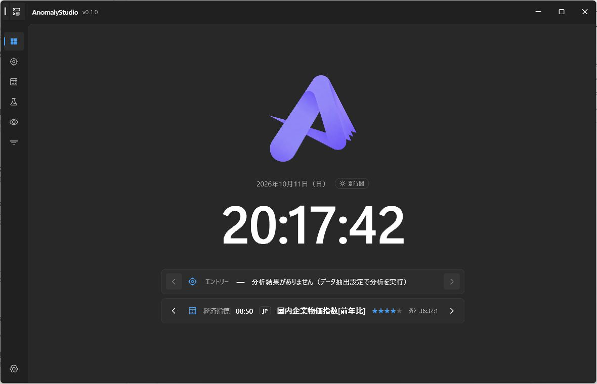

現在のJST時刻、次のエントリー、直近の経済指標、分析状況を確認する画面です。銘柄単位と複合表示を切り替えられます。初回は分析結果がないため、エントリーの案内は表示されません。

時計はWindowsの現在時刻をJSTで表示します。Windowsの時刻がずれている場合は、設定から同期してください。経済指標が表示されていても、市場データの分析が完了したことを意味しません。

## 3. エントリー一覧

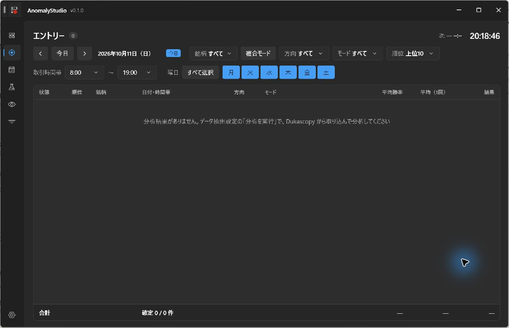

分析で選ばれた最新のポイントを、選択した日の取引予定として表示します。銘柄、方向、モード、時間帯、曜日、上位件数で絞り込めます。「今日」と日付の矢印で表示日を変更します。

表示日を過去に変更しても、その当時の分析ポイントへ切り替わるわけではありません。最新のポイントを過去の日に当てはめた表示です。過去の基準日ごとの選定を確認するには、ウォークフォワードを使います。

次のエントリーと保有中のポイントには残り時間を表示します。取得済み価格があれば終了後の成績を表示し、集計を更新します。列見出しで並べ替えられます。複合表示は対象銘柄の候補をまとめて選びます。

市場が閉まっている時間のポイントは除外します。除外後に下位の候補で上位件数を埋めることはありません。日曜には取引予定がありません。土曜は、ニューヨーク市場の金曜に相当する早朝の時間帯だけが対象になります。

## 4. 経済指標カレンダー

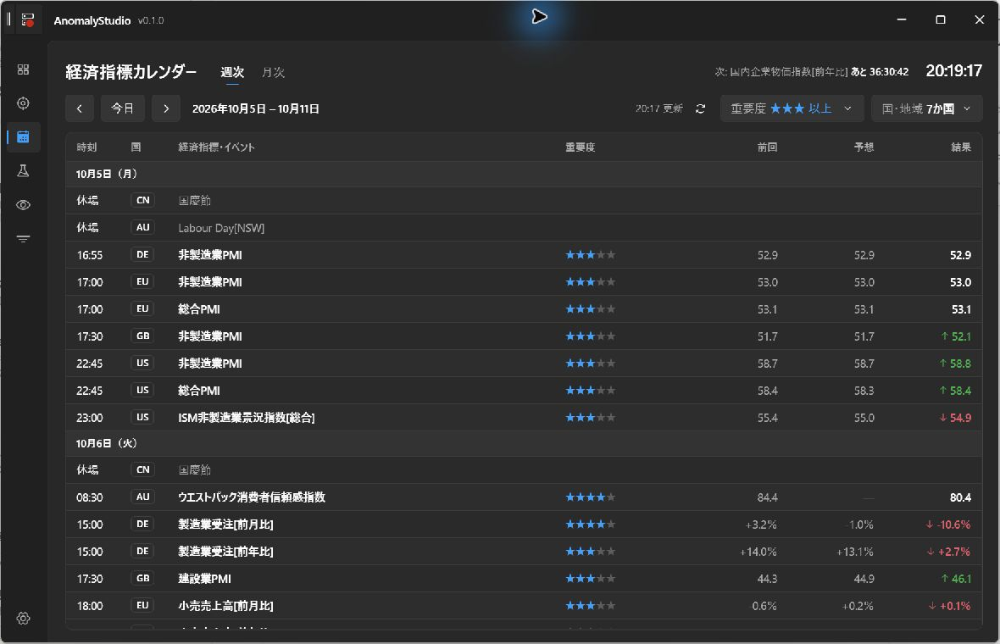

週・月の切替、前後への移動、今日への移動、更新ができます。国と重要度で絞り込み、発表予定・予想・結果を確認します。絞り込み条件は保存され、ダッシュボードと設定にも共通で使われます。

GMOクリック証券の月別カレンダーを取得します。起動時と毎日6:00に更新を確認します。数値の上向き・下向き表示は予想に対する結果の比較で、為替の上昇・下落予測ではありません。祝日は国の条件で表示します。

経済指標の発表時間を分析やバックテストから自動除外する仕様にはなっていません。取引予定と照らし合わせて確認してください。

## 5. データの取込と分析

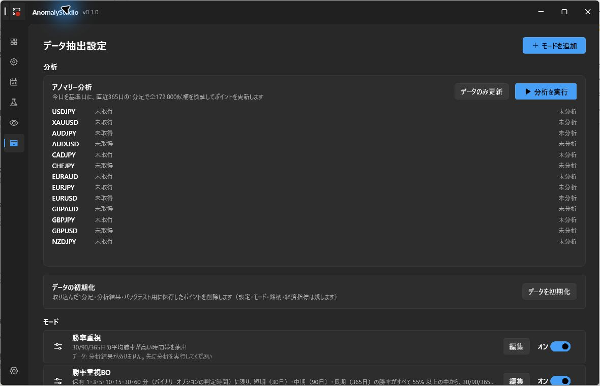

| 操作 | 動作 |
| --- | --- |
| 分析を実行 | 有効な銘柄の1分足を取得し、本日を基準に直前365暦日のデータを使って、有効なモードのポイントを選定します。 |
| データのみ更新 | 市場データを取得します。ポイントの再選定は行いません。 |
| キャンセル | 実行中の処理を中止します。 |
| データ初期化 | 確認後、市場データ・分析結果・ウォークフォワードのキャッシュを削除します。 |

初回は銘柄の状態が「未取得」「未分析」になります。取得・分析の進捗はこの画面で確認します。データ取得には通信と時間が必要です。

起動時のデータ更新は、既に取得履歴のある銘柄を更新する機能です。初回の分析は「分析を実行」から開始してください。

「データ初期化」は設定を含む工場出荷状態へのリセットではありません。設定・銘柄・モード・経済指標は残ります。このマニュアルの作成では実行していません。

## 6. モードと期間別の利益効率

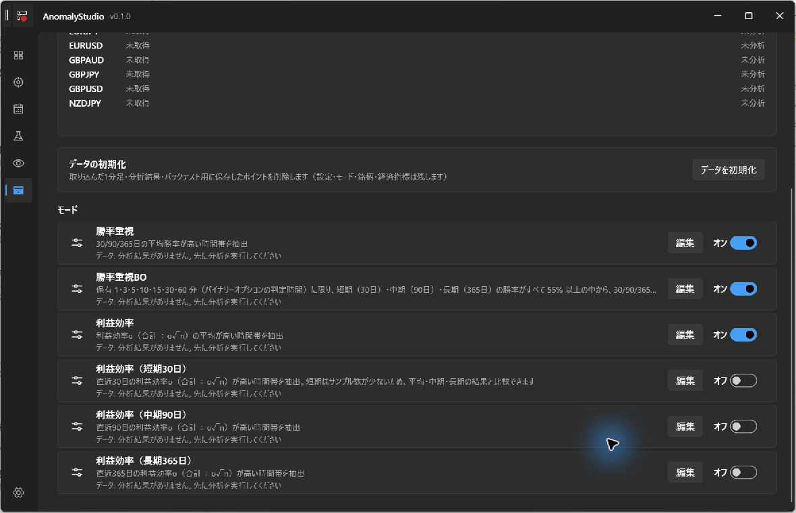

モードのスイッチで、分析するモードを選びます。利益効率には、3期間の平均と、各期間を基準にするモードがあります。

| モード | 評価の基準 |
| --- | --- |
| 勝率重視 | 30日・90日・365日の勝率を使った評価 |
| 勝率重視BO | 保有時間を1・3・5・10・15・30・60分に限定。3期間とも勝率55%以上の候補を、平均勝率で評価 |
| 利益効率 | 30日・90日・365日の利益効率の平均 |
| 利益効率（短期30日） | 30日の利益効率 |
| 利益効率（中期90日） | 90日の利益効率 |
| 利益効率（長期365日） | 365日の利益効率 |

期間別モードも、データ品質の確認には365日のデータを使います。通常の既定モードの保有時間は3〜15分です。銘柄別の選定、複合表示、ウォークフォワードでも選択した期間の評価を使います。

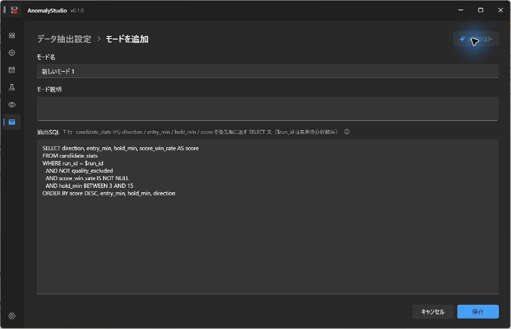

「モードを追加」で名称・説明・抽出SQLを入力し、保存します。新規モードは勝率重視のSQLをひな形として開き、保存直後は無効です。利用するときは一覧で有効にします。キャンセルで保存せず戻れます。

SQLは候補表 `candidate_stats` から、方向・エントリー時刻・保有時間・スコアを返すSELECTです。`$run_id` を使って対象の分析結果を指定し、並び順で優先順位を決めます。保存時に構文を確認します。抽出条件を変える場合は、十分なデータで結果を検証してください。

AIアシストは設定で接続できる状態にしてから使います。要望を入力し、生成・確認・テスト抽出の順に進め、成功後に「反映」します。反映しただけではモードは保存されません。最後にモードを保存します。テスト抽出には分析済みデータが必要です。SQLを手で変更した場合は、再度テストしてください。

撮影では「モードを追加」の遷移を確認しました。既存モードの「編集」は、押しても画面が切り替わりませんでした。上の画像は追加時の画面です。既存モードの編集・既定に戻す・独自モードの削除は実装に存在しますが、今回の撮影では動作確認できていません。

## 7. ウォークフォワード・バックテスト

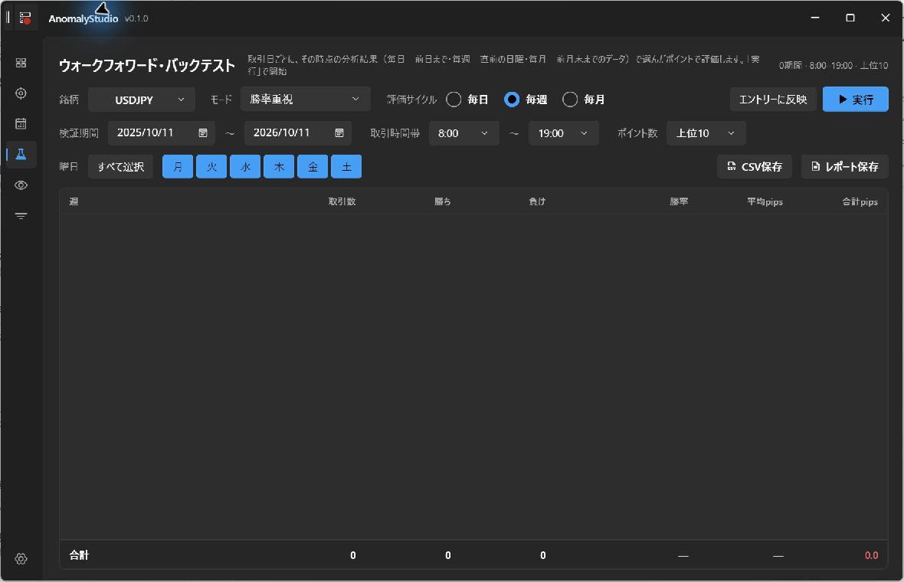

過去の各基準日時点で選べたポイントを、その後の取引日に当てはめて評価します。

1. 銘柄とモードを選びます。
2. 検証期間、評価サイクル、時間帯、上位件数、曜日を指定します。
3. 「実行」を押します。必要な過去データの取得・選定・評価を行います。
4. 結果の行を展開し、各ポイントの取引数・勝率・損益を確認します。

条件を変えただけでは再計算しません。「実行」を押してください。銘柄・モード・検証期間・評価サイクルは保存されます。時間帯・件数・曜日は関連画面と共通の設定です。

| 評価サイクル | 分析の基準日 | 使用データの最終日 | ポイントの適用 |
| --- | --- | --- | --- |
| 毎日 | 各取引日 | 前日 | 当日 |
| 毎週 | 月〜日の週の直前の日曜日 | その前の土曜日 | 同じ週の月〜日 |
| 毎月 | 月初の1日 | 前月末日 | 同じ月 |

例えば2026年10月12日の評価では、毎日は10月12日を基準に10月11日まで、毎週は10月11日を基準に10月10日まで、毎月は10月1日を基準に9月30日までのデータを使います。2026年10月5日〜11日の週に適用するポイントの基準日は10月4日です。

評価サイクルとスコアの期間は別です。毎週を選んでも利益効率の分析期間が7日になるわけではありません。利益効率は30日・90日・365日、期間別モードは指定した期間を評価します。

基準日のJST 0:00以降の価格は選定に使いません。日をまたぐクローズがその境界を越える取引も選定対象から外れます。必要な期間の端で4日を超えるデータ不足がある分析時点は評価できません。未確定の取引、価格データのない取引は、確定成績と分けて表示します。

「エントリーに反映」は、選択した銘柄・モードをエントリー画面に渡す操作です。表示した週のポイントを固定して、次週の注文を予約する操作ではありません。

## 8. 最適化確認

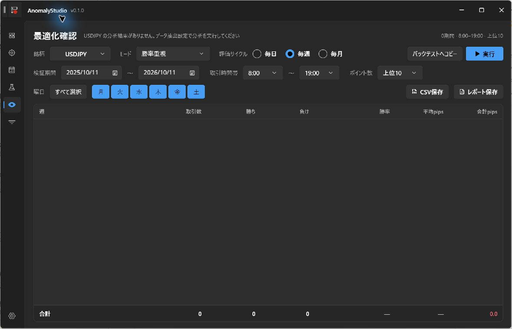

最新の分析で選ばれたポイントを、検証期間内の各取引日に当てはめます。画面上部に、分析の基準日とポイント選定に使った期間を表示します。初回は分析結果がないため結果は空です。

| 比較項目 | 最適化確認 | ウォークフォワード |
| --- | --- | --- |
| ポイント | 最新の分析結果を固定して適用 | 過去の各基準日で選び直して適用 |
| 評価サイクル | 日・週・月の集計単位 | 選び直す頻度と集計単位 |
| 検証期間を変更 | 当てはめる取引日を変更 | 評価する基準日・取引日を変更 |
| 実行 | 表示時・条件変更時にも評価。サイクル変更は再集計 | 「実行」で取得・計算 |

最適化の検証期間を変えても、最新の分析基準日は変わりません。基準日を更新するには「データ抽出」で分析を実行します。

選定に使った期間と検証期間が重なる場合があります。また、スコアは複数期間や保有時間に基づく評価なので、すべての週・ポイントの平均損益が正になるとは限りません。次週以降の成績を保証する表示ではありません。

「バックテストへコピー」で条件をウォークフォワードへ渡し、移動先で「実行」します。最適化とウォークフォワードは、それぞれの銘柄・モード・検証期間・評価サイクルを別々に保存します。保存された日付は、翌日も自動でずれるわけではありません。

## 9. 設定

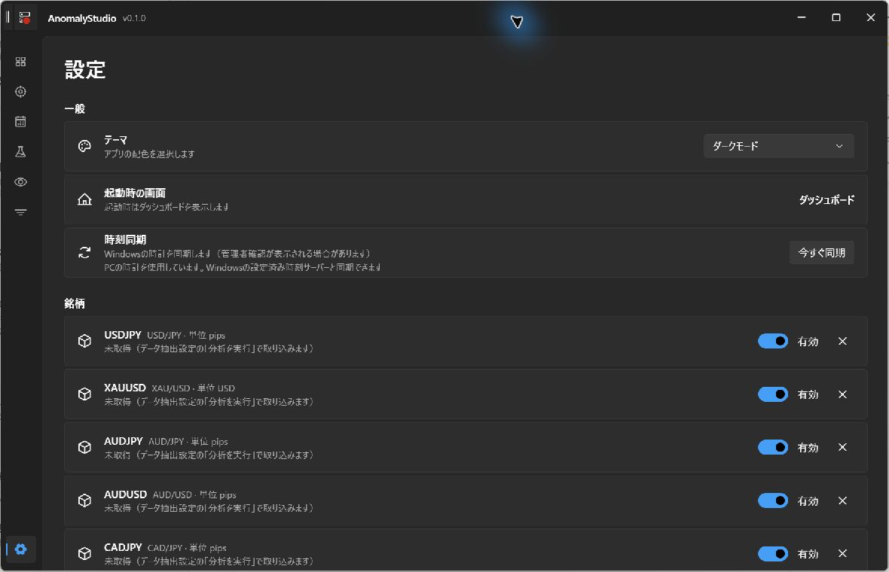

テーマを変更し、対象銘柄を管理します。起動画面は常にダッシュボードです。最後に開いた画面を復元する設定はありません。

Windows自体の時刻を同期する場合は、次の手順です。

1. 「Windows時刻同期」の「今すぐ同期」を押します。
2. Windowsの管理者承認が表示されたら、内容を確認して承認します。
3. アプリに表示される完了・失敗の状態を確認します。

Windows Timeサービスと `w32tm /resync` を使います。設定済みの時刻サーバーは変更しません。管理者承認のキャンセル、通信・サービスの問題で失敗する場合があります。このマニュアルの撮影では実際の時刻変更を実行していません。

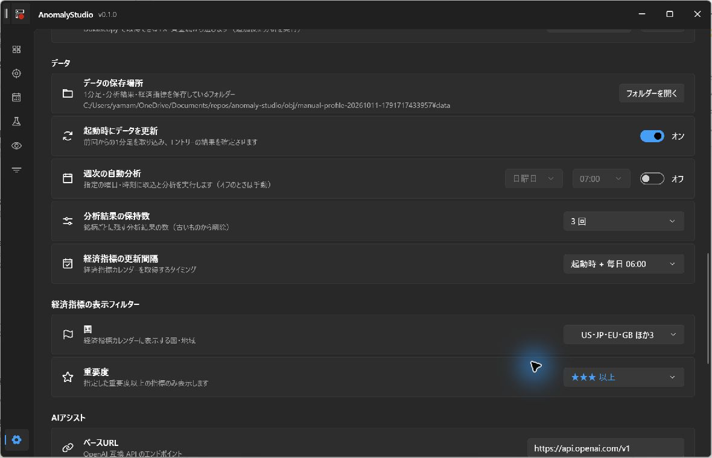

データ保存先、起動時データ更新、週次自動分析、結果の保持数、経済指標の設定を確認できます。画像の保存先は撮影用で、通常の保存先とは異なります。

週次自動分析は、アプリが起動している間に実行します。Windowsの常駐タスクとして動作する機能ではありません。起動後は1分ごとに予定を確認し、予定時刻を過ぎて未実行なら分析を開始します。既定の予定は日曜日7:00で、初回は無効です。結果保持数の既定値は銘柄ごとに3件です。

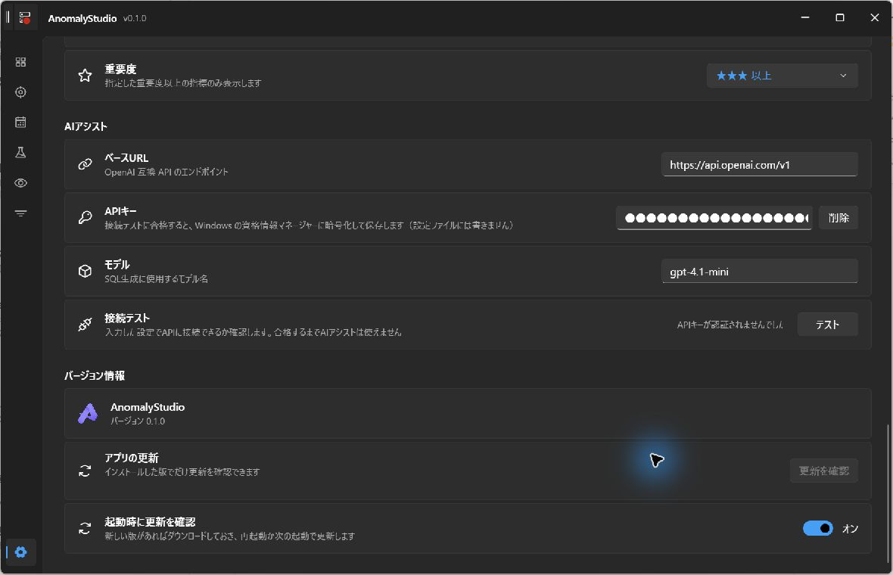

AIアシストを使う場合は、OpenAI互換APIのURL、APIキー、モデルを設定します。既定のURLは `https://api.openai.com/v1`、モデルは `gpt-4.1-mini` です。接続状態を確認してから、モード編集のAIアシストを利用します。

APIキーはWindows資格情報に保存します。設定JSONには保存しません。画像ではマスクされています。撮影環境では既存の資格情報が残っており、接続失敗が表示されています。この表示は全利用者共通の初期状態ではありません。

「バージョン情報」でアプリの版を確認します。画像の開発実行はv0.1.0です。アプリ更新はインストール版で利用する機能で、開発実行では更新ボタンが無効です。

## 10. 成績の保存とデータの場所

ウォークフォワードと最適化の「CSV保存」は取引明細を、「レポート保存」は集計・統計をCSVとして保存します。「レポート保存」はHTMLやPDFの出力ではありません。保存先はドキュメント内の `AnomalyStudio` です。CSVはUTF-8 BOM付きです。

取引数、勝ち・負け、勝率、平均・合計の値動きに加え、t値、95%信頼区間、プロフィットファクター、最大ドローダウン、最大連敗を表示します。ランダム基準は同じ日・件数・時間帯から選ぶ200試行です。

表示損益には設定されたスプレッドの影響があります。銘柄の値動きの単位と金額は同一ではありません。複数銘柄の数値を合算した表示を、そのまま円建て収益や投資収益率とは解釈できません。

| 通常の保存先 | 内容 |
| --- | --- |
| `%LOCALAPPDATA%/AnomalyStudio` | アプリの設定とデータのルート |
| ルートのJSON | 設定、モード、銘柄 |
| `data/market` | 銘柄・月別の市場データ（Parquet） |
| `data/anomaly.duckdb` | 分析結果・検証用データベース |
| 経済指標用の保存領域 | 月別カレンダーのキャッシュ |
| `logs` | 実行ログ |
| ドキュメントの `AnomalyStudio` | 保存したCSV |

データを移す・削除する前に、アプリを終了し、必要なファイルをバックアップしてください。

## 11. 困ったときと確認範囲

| 状況 | 確認すること |
| --- | --- |
| ポイントが表示されない | 対象銘柄とモードが有効か、分析が完了したか、日付・時間帯・曜日で除外されていないか。 |
| 起動時更新後もポイントが古い | データ更新だけでは選び直しません。「分析を実行」で更新します。 |
| 検証の条件変更が反映されない | ウォークフォワードは「実行」が必要です。 |
| 最適化の週にマイナスがある | 最新ポイントの当てはめと、選定スコアの評価期間は別です。各週の利益を保証しません。 |
| 時刻同期に失敗する | 管理者承認、Windows Timeサービス、ネットワーク、表示されたエラーを確認します。 |
| AI接続に失敗する | URL、利用可能なモデル、APIキー、接続先の認証方式を確認します。 |
| 既存モードの編集画面が開かない | 今回の撮影でも発生しました。未修正のため、既存モード編集の動作は確認できていません。 |

今回確認したのは、主要画面への移動、初回既定値と空データの表示、新規モード画面への移動、設定画面、経済指標の自動取得です。11枚の画像は実画面の未加工キャプチャです。開発用表示やマウスポインターが含まれる場合があります。

市場データの分析実行、ウォークフォワードの計算、CSV出力、AI生成・反映、Windowsの時刻変更、データ初期化は、今回の撮影では実行していません。これらの手順は現行ソースから確認しています。画像は初期状態のため、分析後の結果画面の実例は含みません。

## 12. この資料の更新方法

このMarkdownが本文の編集元です。画像は `images`、撮影情報は `captures.json` にあります。開発リポジトリのルートで `node scripts/build-manual.mjs` を実行すると、画像を内蔵した `docs/manual/index.html` を再生成します。公開リポジトリとインストーラーには生成済みの資料を含めます。生成スクリプトは開発リポジトリだけにあります。

導入・更新の手順は[導入マニュアル](https://github.com/HatchSystem/anomaly-studio-oss/blob/main/docs/INSTALL.md)、計算の詳細は[分析仕様](../design/anomaly-engine.md)を参照してください。
